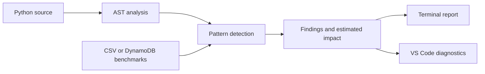

# Carbon-Aware Code Analyzer

**Explore the carbon impact of everyday Python choices.**

Carbon-Aware Code Analyzer inspects Python source code, identifies patterns with more efficient alternatives, and estimates the difference using measured benchmark profiles. It brings those findings into both the terminal and VS Code, with suggestions alongside the code they describe.

## What it does

- **Finds optimization opportunities** in summation, filtering, transformations, recursion, membership checks, string building, and queue operations.
- **Explains each finding** with its location, a suggested alternative, and a confidence label.
- **Estimates carbon impact** using benchmark measurements normalized per operation.
- **Works inside VS Code** with inline hints, hover details, and diagnostics.
- **Adds grid-aware advice** through an optional ElectricityMaps integration for execution windows and cloud-region comparisons.
- **Supports local and cloud data** through the included CSV dataset and an AWS DynamoDB integration.

## A simple example

```python
registered_users = ["Asha", "Ravi", "Mira"]

if username in registered_users:
    allow_access()
```

The analyzer recognizes list membership and suggests considering a set for repeated lookups. Its report connects the suggestion to the relevant source line and benchmark comparison.

## How it works



The analysis reads the source without executing the program being inspected. Benchmark profiles provide the energy and carbon estimates, while a separate workload score informs optional scheduling advice.

## Try it locally

Requires Python 3.10 or newer.

```bash
git clone https://github.com/DebapriyaK/Cloud_comp.git
cd Cloud_comp
python -m venv .venv
```

Activate the environment with `.venv\Scripts\Activate.ps1` on Windows PowerShell or `source .venv/bin/activate` on macOS/Linux, then run:

```bash
python -m pip install -r requirements.txt
python carbon_analyzer.py demo_dirty.py
```

For machine-readable output:

```bash
python carbon_analyzer.py --json demo_dirty.py
```

The analyzer uses DynamoDB when available and falls back to `emissions_dataset.csv` for local analysis.

## Use it in VS Code

The extension supports local Python and Docker execution. Follow the [extension setup guide](vscode-extension/INSTALL.md) to install the packaged extension and configure its runtime.

For local execution, set `carbonAnalyzer.executionMode` to `local` and `carbonAnalyzer.analyzerScript` to the absolute path of `carbon_analyzer.py`. Open a Python file and save it to see the findings.

## Explore the code

| Component | Purpose |
| --- | --- |
| [`carbon_analyzer.py`](carbon_analyzer.py) | Source analysis, pattern detection, and reports |
| [`benchmark_suite.py`](benchmark_suite.py) | Workload benchmarks using CodeCarbon |
| [`grid_advisor.py`](grid_advisor.py) | Grid-intensity and scheduling advice |
| [`aws_dataset.py`](aws_dataset.py) | DynamoDB dataset integration |
| [`vscode-extension/`](vscode-extension/) | Editor integration |
| [`samples/`](samples/) | Example programs to explore |

**Built with:** Python, the Python AST, Rich, CodeCarbon, JavaScript, the VS Code extension API, Docker, and AWS DynamoDB.
